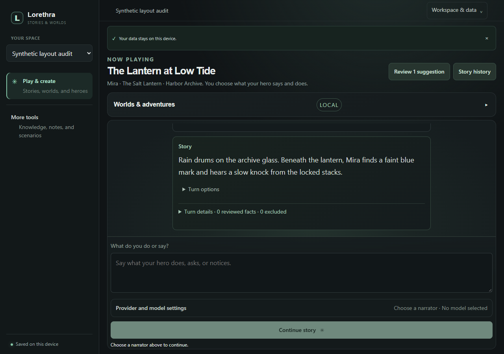
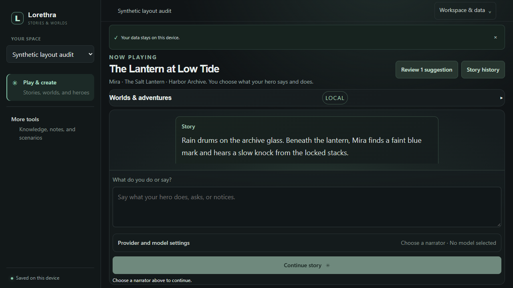
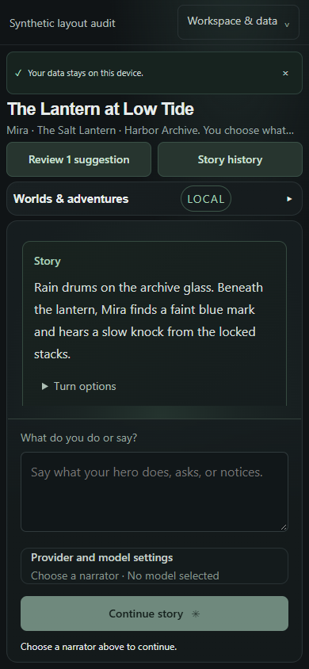
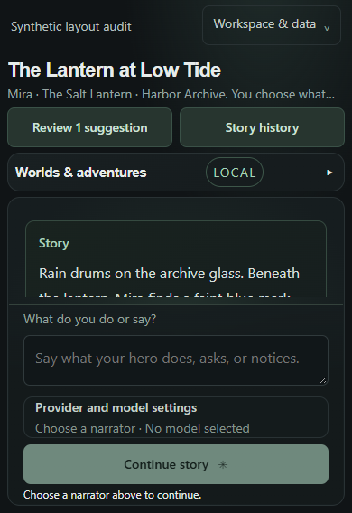
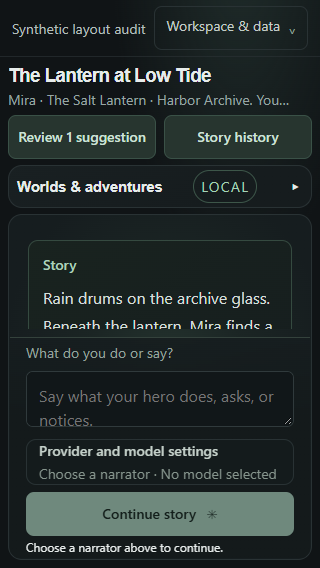
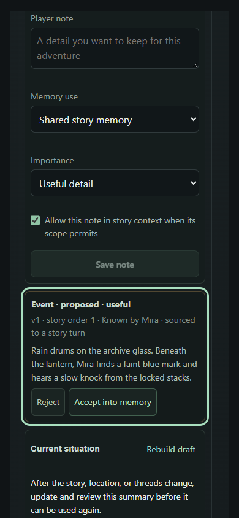
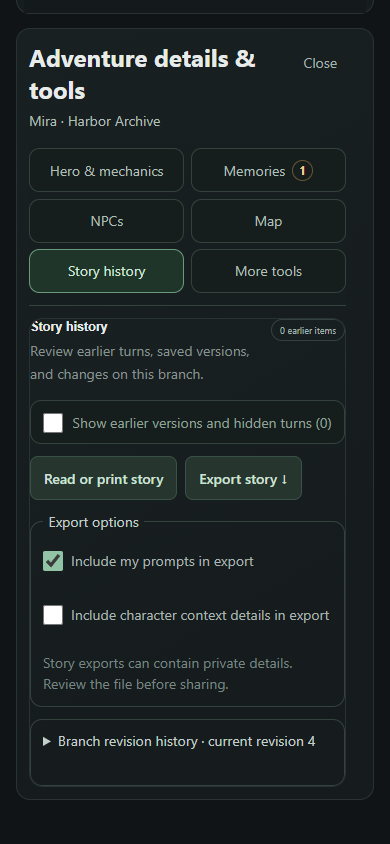
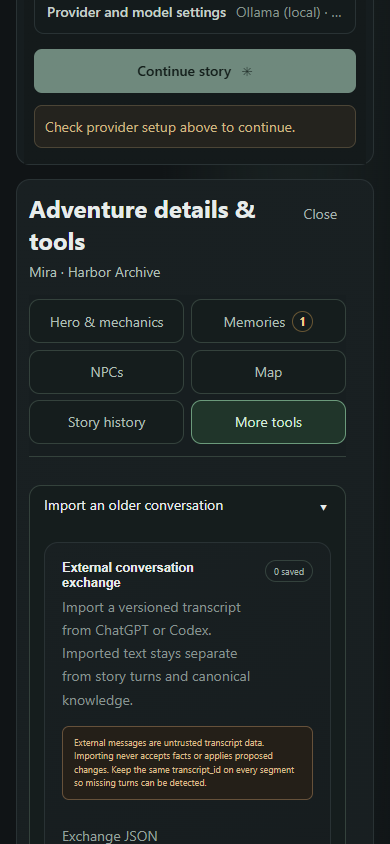

# Responsive Story Studio composer and contextual tools

**Current source:** c8b3ce3 on codex/lorethra-platform-refinement
**Date:** 2026-11-07
**Browser:** Microsoft Edge 155 headless via the local Playwright driver
**Fixture:** disposable synthetic SQLite workspace and adventure only

This follow-up checks the committed active-play layout and first-action path. It does not replace the earlier [baseline replay](story-layout-browser.md), whose before screenshots were captured at source c0ceca2. The after screenshots below use source c8b3ce3.

## Journey and observations

The replay resumed a saved synthetic adventure, entered mixed Persian/English draft text, opened narrator settings, opened the pending-memory review, visited story history, then found and expanded the older-conversation importer under **More tools**.

| Viewport | Transcript height | Continue visible | Latest turn visible | Document width |
|---|---:|---|---|---:|
| 1280 × 900 | 271 px | Yes | Yes | 1280 px |
| 1280 × 720 | 126 px | Yes | Yes | 1280 px |
| 390 × 844 | 216 px | Yes | Yes | 390 px |
| 390 × 568 | 93 px | Yes | Yes | 390 px |
| 320 × 568 | 96 px | Yes | Yes | 320 px |

The composer and its disabled Continue action remain in the viewport at all five sizes; no horizontal document overflow was measured. On the shortest/narrowest viewports, the transcript is intentionally a compact internal scroll region, so only about one or two story lines are visible at 320 × 568 before scrolling within it. This keeps the next action reachable but limits simultaneous reading space.

The draft survived navigation. Typing caused zero network requests and zero canonical writes. Without a selected narrator, Continue was disabled and its explanatory message was connected through aria-describedby. Keyboard focus showed a 3 px outline with a 2 px offset.

Pending review opened the relevant proposal, moved focus to it, and returned focus to the review opener when closed. Story history opened on its selected section and returned focus on close. The existing older-conversation import form was discoverable and expandable from **More tools**, without occupying the active-play page.

## Network and build evidence

The settled browser run recorded 357 requests: all 357 responses were HTTP 200, all origins were local Vite/API origins, and there were no external origins, console issues, or page errors. Narrator discovery returned 200 in 4,560 ms; the optional ComfyUI availability check returned 200 in 2,264 ms. These status checks were triggered by opening their respective settings/tools. They did not submit generation requests. Their latency is a responsiveness question for optional controls, not a typing cost.

npm run build passed at c8b3ce3. Vite reports a 561.02 kB JavaScript chunk (148.65 kB gzip), above its 500 kB advisory threshold. A passing build and this synthetic browser journey do not establish overall usability or release readiness.

## Before and after captures

The earlier [baseline report](story-layout-browser.md) includes the before screenshots. The following captures show the committed source:

### Desktop and short window

### Phone widths

### Contextual details

Machine-readable, privacy-scrubbed measurements are in [story-composer-results.json](story-composer-results.json).

## Limits and next checks

This was a scripted role-based journey on disposable data. No human new user or creator participated. No narrator model was selected, so generation, stop, failure, and retry were not exercised. The run did not test native screen-reader speech, the on-screen keyboard, 200 percent zoom, contrast, reduced motion, or Persian editing caret behavior. It did not launch Tauri or live ComfyUI. Clean-machine Windows, installed WebView behavior, the full history mutation matrix, and whole-platform task journeys remain open.
