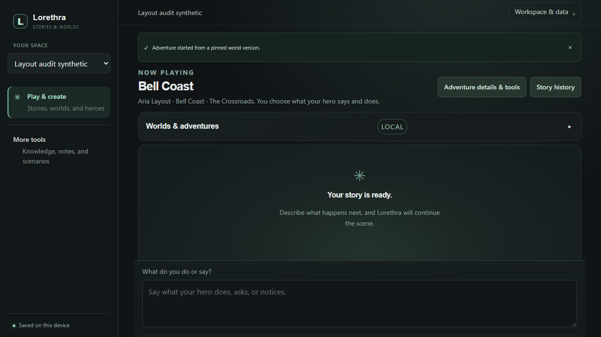
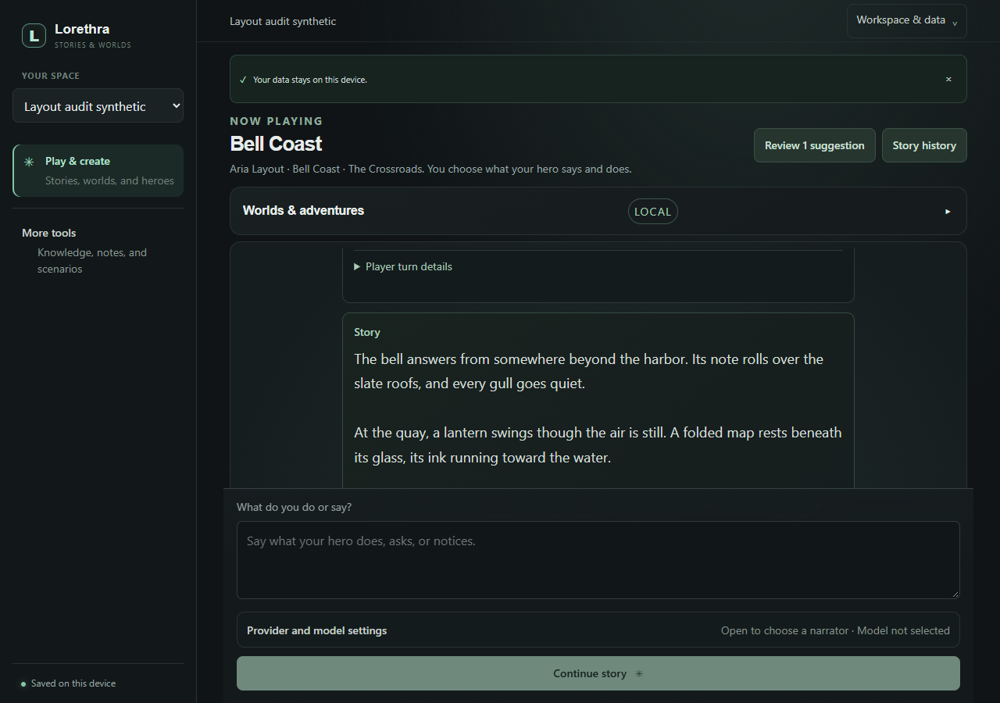
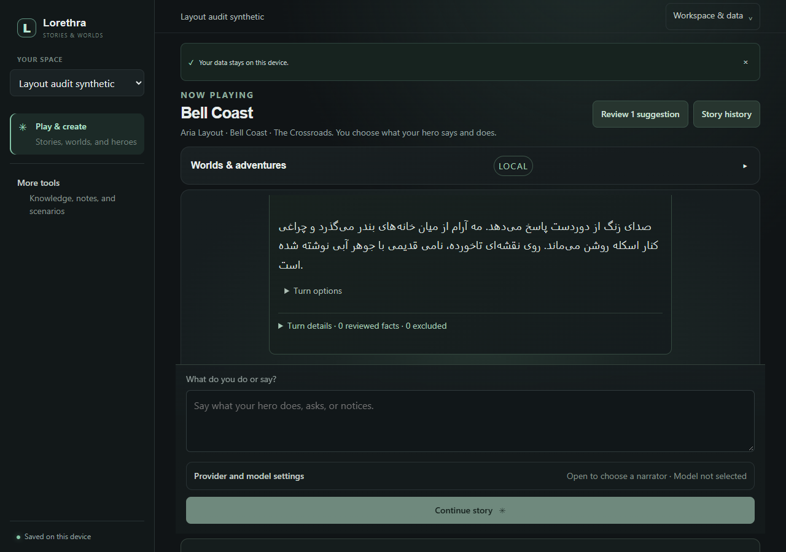
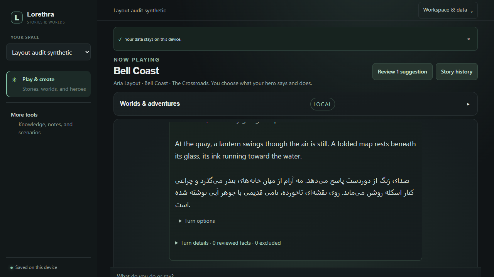
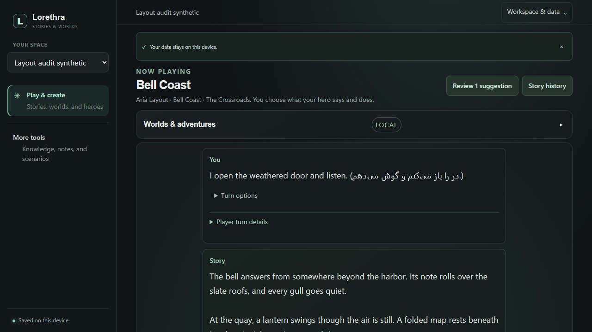
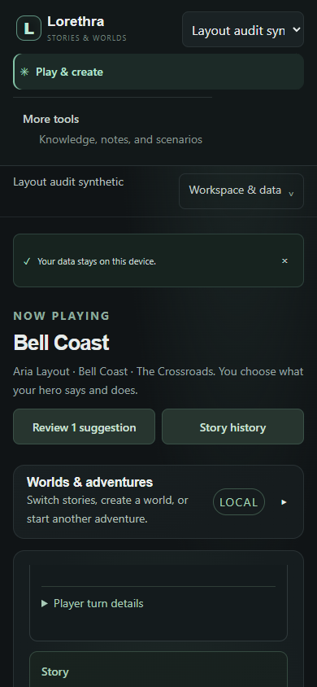
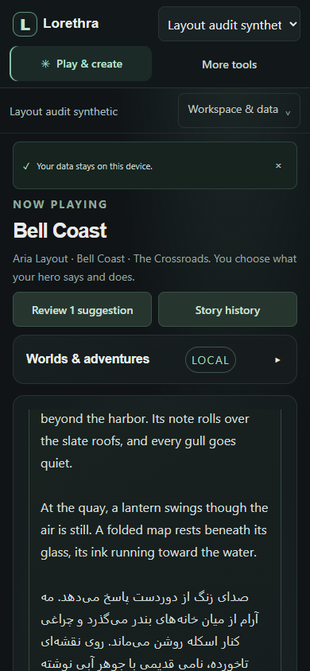
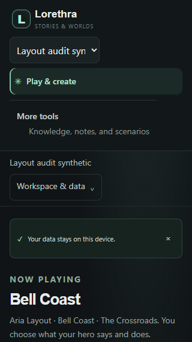
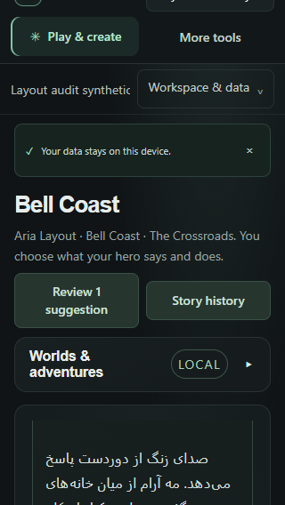

# Story Studio responsive browser replay — 2026-11-07

- **Application source:** c0ceca2c373f24446f6cceba85703dbc5daf232a
- **Branch:** codex/lorethra-platform-refinement
- **Base:** cfb1bac5d7298e12e949041ceded81d2fb6d8eda
- **Browser:** Microsoft Edge 155, headless Playwright CLI
**Build:** npm run build passed after the CSS changes; Vite reports the existing 560.17 kB JavaScript chunk above its 500 kB advisory.

## Scope and fixture

The journey used only the disposable SQLite workspace named “Layout audit synthetic” and synthetic bilingual story text. The local Vite and API origins were 127.0.0.1:5173 and 127.0.0.1:48124. No owner data, Tauri process, hosted service, or narrative/image provider was used. No narrator model was selected, so the Continue story action was visibly unavailable; this replay checks the rendered saved-story journey and layout, not AI generation or failure/retry.

The MNO tree was reviewed as source, not run. Bestaigen’s downloaded tree has no index.html or src/Designbook.enc, so its full product flow and visual hierarchy could not be executed or verified. The reviewed source findings and assumptions are in the [platform refinement plan](../../../PLATFORM_REFINEMENT_PLAN.md).

## Finding and change

At 1280 × 900 before the change, the sticky composer covered the lower story content. At 1280 × 900 after the change, the bounded transcript ended at y=578 and the composer began at y=594, leaving a 16px gap. The transcript scroll position remained usable. At short desktop height, the transcript and composer move into ordinary document flow so the composer no longer overlays turns. At widths up to 760px, active-play navigation is compacted into a two-row grid. At 320px, a further compact rule hides the eyebrow and allows the two story actions to share the row.

This is a scoped layout correction. It does not establish that the whole product is easy to use, that every capability is discoverable, or that a mobile composer can remain in the first viewport.

## Measured layouts

| Viewport | Before | After | Result |
|---|---|---|---|
| 1280 × 900 | Composer began at y=625 while transcript content continued behind it. | Transcript y=318–578; composer y=594–870. | 16px separation; no overlap. |
| 1280 × 720 | Earlier capture showed the transcript/composer conflict. | Transcript y=318–998; composer y=1014–1290, in page flow. | No overlap; composer is below the viewport and reachable by page scroll. |
| 390 × 844 | Tall navigation consumed more of the first view. | Compact navigation; transcript y=515–1022; composer y=1038–1321. | No horizontal overflow or overlap; composer needs a modest page scroll. |
| 320 × 568 | Tall navigation dominated the viewport. | Compact navigation; document width equals 320px; transcript y=473–813; composer y=829–1113. | No horizontal overflow or overlap. Resume leaves the page scrolled by about 39px, trimming the top of the sidebar; composer requires page scroll. |

At 320px the story appears sooner after resume, but the scroll position clips the brand row. That deserves a follow-up in the full mobile flow. The current layout keeps controls reachable; it does not keep the composer continuously visible on short mobile screens.

## Journey, focus, and content checks

- Resumed the saved synthetic adventure and confirmed the story, review cue, story-history action, and composer are present in the active view.
- Mixed Persian and English story text rendered without horizontal document overflow.
- The visible Review 1 suggestion action opened the relevant pending review item. The item received focus, and closing the details area returned focus to the opener.
- Keyboard Tab reached the review control with a visible focus outline.
- The accessibility snapshot exposed Main navigation, More tools, a named story conversation, and the composer label. The transcript declares aria-live off; this avoids announcing the entire transcript on changes but needs native assistive-technology testing alongside the separate status announcements.

## Network and console

The recorded Playwright request summary counted 79 requests: 26 to the Vite origin and 53 to the isolated local API; no external origin or provider call was observed. The browser reported zero console errors and zero warnings. The exact HTTP status breakdown was not retained for this replay and is deliberately not inferred. See [network summary](network-summary.json) and [accessibility observations](accessibility-summary.json).

## Captures

**New-user synthetic first-use**

**Desktop 1280 × 900**

Before:

After:

**Short desktop 1280 × 720**

Before:

After:

**Mobile 390 × 844**

Before:

After:

**Mobile 320 × 568**

Before:

After:

## Remaining checks

No actual new user or creator participated. Native screen-reader output, 200 percent zoom, contrast, reduced motion across the app, mobile on-screen keyboard behavior, and Persian editing caret/selection remain untested. The synthetic story had no selected narrator, so generation, stop, failure, and retry were not exercised. The 320px composer remains below the initial viewport. The MNO and Bestaigen runtimes were not launched. Clean-machine Windows and installed WebView behavior remain release gates.
