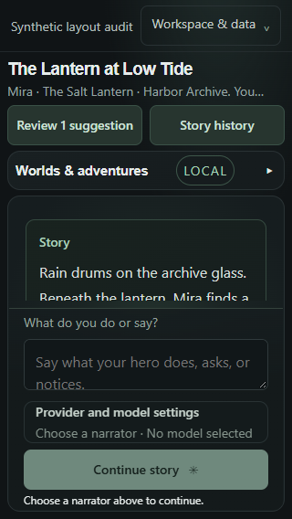
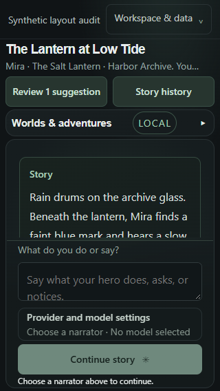
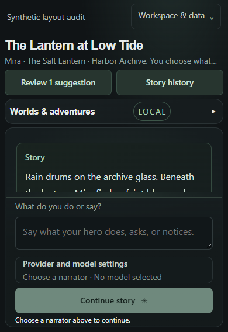
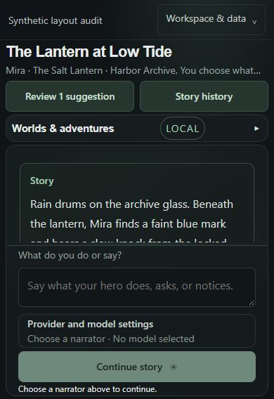
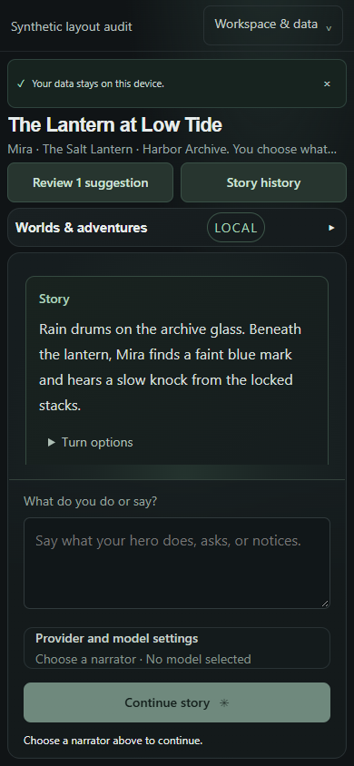
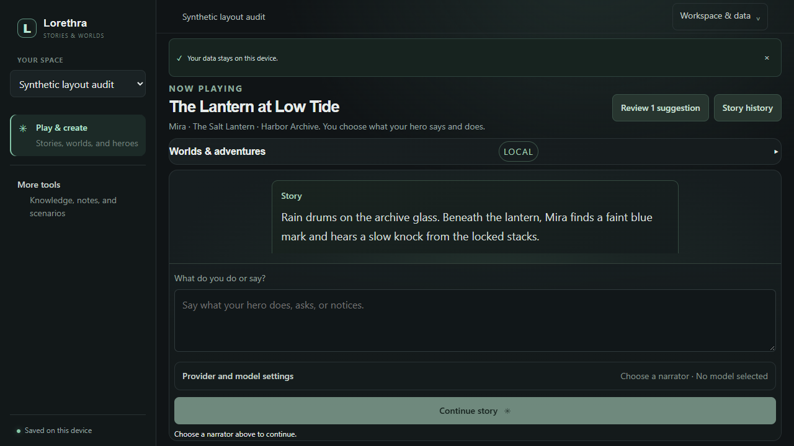

# Short-window story reading

**Before source:** c8b3ce3
**After source:** 7c4d93f
**Date:** 2026-11-07
**Browser:** Microsoft Edge 155 headless through the authorized local Playwright driver
**Fixture:** disposable synthetic SQLite workspace and adventure; no owner data

## Audit scope

A returning player should be able to read the current scene and reach the next action in a narrow, short-height window. The adjustment only changes spacing for active play at widths up to 720px and heights up to 640px. It keeps the provider status, text field, review/history actions, and 44px primary target.

## Steps and findings

1. **Resume at 320 × 568 and 390 × 568.** Before the change, the transcript viewport measured 96px and 93px. After, it measured 124px and 121px respectively: a 28px gain at both widths. The Continue control, helper, and composer stayed in view with no horizontal overflow. The textarea stayed at 56px and the primary control stayed at 44px.
2. **Check the unaffected comparison sizes.** The 390 × 844 transcript remained 216px; the 1280 × 720 transcript remained 126px. This change is limited to short mobile windows.
3. **Use the keyboard and preserve a draft.** At both short phone sizes, keyboard navigation reached the composer in 10 Tab presses from reset focus. Its outline was visible at 3px with a 2px offset. Mixed Persian/English text remained in the draft; typing caused zero requests and zero canonical writes. The disabled Continue action kept its associated “Choose a narrator above to continue” guidance.
4. **Open and close review and history.** The pending suggestion received focus, and closing returned focus to its opener. Story history opened, and closing returned focus. These paths remained reachable at both short sizes.

## Before and after captures

### 320 × 568

### 390 × 568

### Layout comparison

## Network, build, and limits

The scripted run recorded 355 requests; every response was HTTP 200. Requests stayed on local Vite/API origins. There were no console issues or page errors. npm run build passed; the JavaScript chunk remains above Vite’s 500 kB advisory.

The content pane is still only 121–124px high at these short sizes, so only a few lines appear before internal scrolling. Keyboard navigation took ten Tab presses from the reset focus; a direct skip path remains an opportunity. Native screen-reader speech, the on-screen keyboard, 200 percent zoom, contrast, reduced motion, human participant tasks, Tauri, clean-machine Windows, and live provider generation were not exercised. The layout change does not establish overall usability or release readiness.

Machine-readable, privacy-scrubbed results are in [story-short-window-results.json](story-short-window-results.json).
