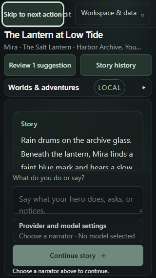
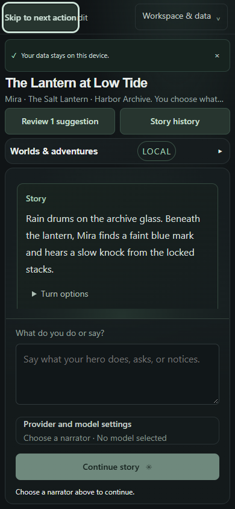
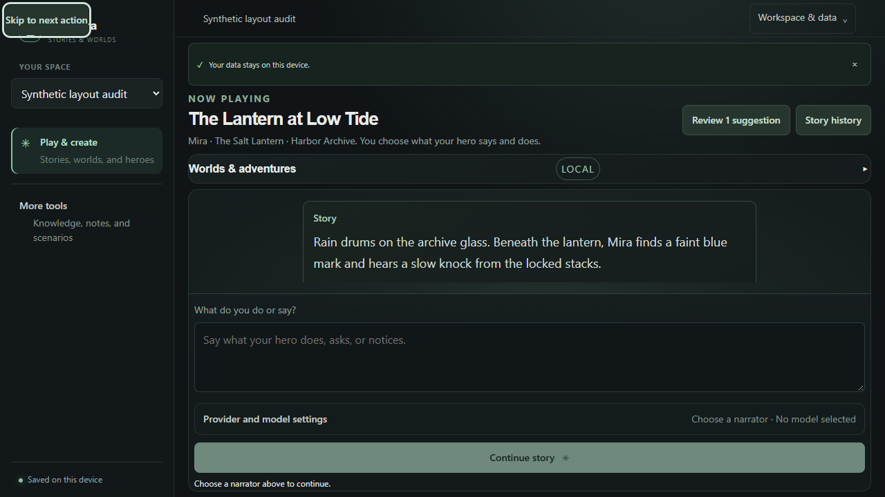

# Keyboard route to the next story action

**Application source:** `6211008ccf412273e1aa967069f3dac451d30a94`  
**Branch:** `codex/lorethra-platform-refinement`  
**Date:** 2026-11-07  
**Browser:** Microsoft Edge 155 headless through the authorized local Playwright driver  
**Fixture:** disposable synthetic SQLite workspace and adventure; no owner data

## Journey and observed result

After resuming the synthetic adventure, the keyboard user reaches **Skip to next action** in four Tab presses. Enter moves focus to the existing “What do you do or say?” textbox. At 320 × 568, 390 × 844, and 1280 × 720, the focused control is visible, mixed Persian/English draft input remains intact, typing causes zero network requests, and the document does not overflow horizontally.

The focused shortcut is positioned at the top-left edge and covers part of the noninteractive Lorethra brand label while it has focus. The story title, review/history actions, transcript, and composer remain visible. The screenshots retain this behavior for review; native screen-reader output and other assistive technology were not available in this run.

Before the shortcut, the source-7c fresh post-resume sequence to the composer was nine Tab stops. The follow-up path is now four Tabs plus Enter. This is a browser keyboard check, not evidence of screen-reader speech or complete keyboard accessibility.

## Captures

## Limits

No native screen reader, 200 percent zoom, contrast measurement, reduced-motion preference, on-screen keyboard, physical Windows resizing, human participant task, live provider, or packaged application was tested. The short-window transcript remains a small internal scroll area. See [scrubbed measurements](story-skip-composer-results.json).
