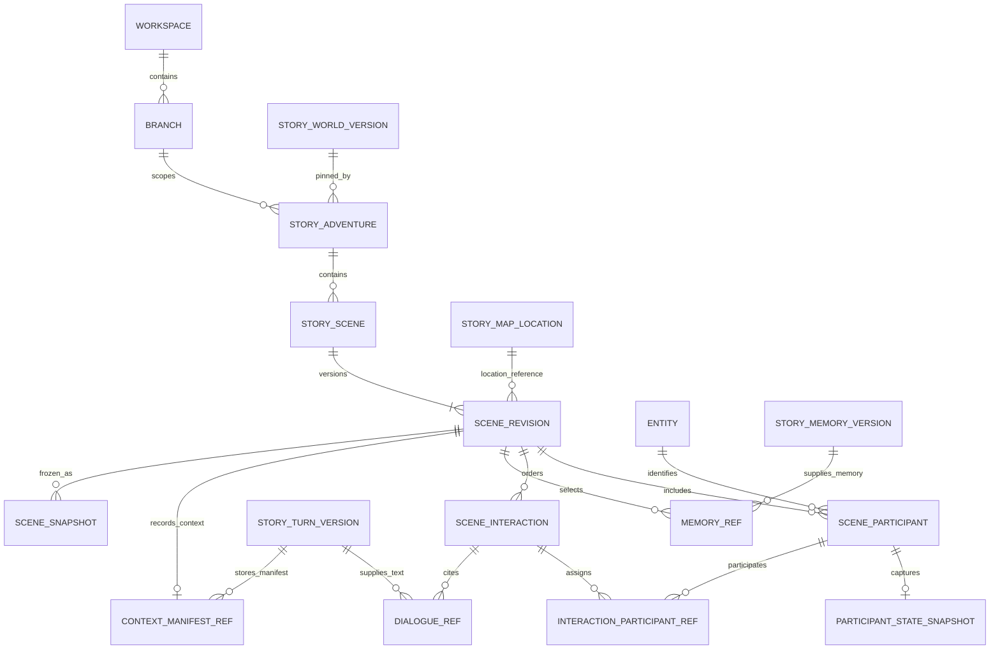

# Scene Domain Contract — L-03

**Status:** L-05 lifecycle commands and scene reads implemented; L-06 participant and reference validation implemented; L-07 immutable snapshots implemented; Scene Studio UI pending

**Contract:** `lorethra.story-scene.v2` for new writes; v1 retained for history; `lorethra.scene-snapshot.v2` is the persisted snapshot envelope; v1 remains design-only

**Date:** 2026-11-24

This is the canonical domain contract for StoryScene. Schema v21 introduced stable scene identity and complete immutable revision payloads; schema v22 allows the gateway to store v2 while retaining legacy v1 revisions. L-05 implements create/edit/lifecycle/archive commands, branch-scoped retrieval, and scene-aware fast-forward promotion. L-06 validates participant identities, approved locations, NPC profiles, knowledge scope, visual assets, interaction participants/order, and exact cross-domain provenance. Read routes are present in the API source but runtime verification is open because FastAPI is unavailable in the current environment. L-07 owns immutable scene snapshots, L-08 owns the Scene Studio UI, and L-09 owns the Scene Architect.

## Domain boundary

A scene is an authored unit of narrative planning and progression inside one adventure branch. It can span multiple story turns, contain no dialogue, and have a lifecycle of its own. It is not an adventure, conversation, story turn, image, or 3D shot. Its identity and history are separate from those records.

The Scene domain owns scene revisions, scene-local participant links, ordered interactions, lifecycle state, and immutable snapshots. It references existing records for world versions, adventures, branches, entity identities, approved locations, story turns and edits, RPG checks, accepted memories, and context manifests. It does not create competing copies of those records.

## Conceptual ER diagram

The diagram shows conceptual records and relationships, not a SQL migration plan. `StoryScene` and its revisions exist from schema v21; schema v22 retains v1 payloads and writes v2 payloads. Participant and interaction data are nested in each scene payload. Separate snapshot records follow L-07.

References are workspace-, adventure-, and branch-scoped. V2 validates them against the selected branch or its explicit fork/promotion lineage. This conceptual diagram does not decide table normalization.

## Record definitions

| Record | Ownership and identity | Contract meaning |
|---|---|---|
| StoryScene | Scene domain; key is `(workspace_id, branch_id, scene_id)` | Stable scene identity within an adventure branch. Its ID stays stable across revisions. A fork copies the scene as of the exact parent revision; edits in the child remain isolated. |
| SceneRevision | Scene domain; `(workspace_id, branch_id, scene_id, scene_revision)` | Append-only complete scene definition. `scene_revision` is scene-local and starts at 1; `source_branch_revision` identifies the canonical branch revision that committed it. |
| Scene participant | Scene domain; participant ID is unique within its scene revision | Links one existing character/person `entity_id` to a scene role, participation status, optional approved current location, scene-local state, optional emotional state, knowledge-scope annotation, and up to four optional character visual asset IDs. Protagonists, recurring NPCs, and temporary background participants use the shared entity identity; a scene does not mint a parallel profile. An NPC also requires a non-rejected adventure NPC profile when first linked. |
| Participant state snapshot | Scene domain, embedded in a scene revision | Sparse, frozen, scene-relevant state at a declared branch revision, with source references and a digest. It is not the character profile, NPC profile, or RPG sheet. `not_captured` represents missing evidence without inventing a state. |
| Scene interaction | Scene domain; stable interaction ID within the scene | A planned beat or recorded interaction with a positive, unique scene-local ordinal, optional actor/targets, type, action, intent, emotional beat, and exact turn/check/proposal source references. Serialized interactions are normalized by ordinal. It is distinct from dialogue text and from a canonical event. |
| Dialogue reference | Narrative owns the source turn/edit | Identifies an exact conversation turn and either its immutable base content or an immutable edit version, plus a hash of the exact UTF-8 content. The scene stores no copied dialogue. |
| Memory reference | Memory owns the source memory version | Identifies a specific accepted memory version and its create/review revisions. Eligibility and actor knowledge rules are evaluated by the Memory/Context domains; a scene link cannot widen access. |
| Context manifest reference | Context owns the manifest; Narrative stores it with its source turn/edit | Identifies the exact `lke.context.v1` manifest, source turn version, context revision, and digest. It is provenance, not a second memory store. A draft may have no manifest. |
| Location reference | World/map owns the location | Optional reference to an approved `story_map_locations` record in the same adventure branch. The selected location must be approved as of the scene revision. The display label in a frozen snapshot is read-only derived data. |
| Scene snapshot | Scene domain; stable snapshot ID | Immutable frozen scene revision, historical RPG/NPC state, resolved reference digests, capture provenance, and content hash. It includes the full scene contract payload and captured participant state. |

### Scene and adventure scope

Each scene belongs to exactly one existing `story_adventures` record in one workspace and branch. That adventure already pins `world_id` and integer `world_version`; the scene contract carries the resolved `world_ref` so a snapshot is self-describing. Commands must verify that the supplied world reference equals the adventure's immutable pin. It is a reference for integrity and reproduction, not a second editable world relationship.

When present, the protagonist participant must resolve to the adventure's existing `actor_entity_id`. An NPC participant uses the same entity ID referenced by its adventure-scoped NPC profile. Private NPC profile content is not copied into the scene. Other character profiles and RPG state remain owned by their existing domains.

`location_ref` is null when there is no approved map location. Do not copy a free-form location into a second location store or promote an unapproved proposal by attaching it to a scene.

## Ordering and fictional time

`scene_sequence` orders scenes within one `(workspace, branch, adventure)` at a specific branch revision. It is the narrative sequence, independent of conversation turn order and in-world time. Gaps are allowed. Reordering is an explicit revisioned operation; snapshots retain their captured ordering.

Within a scene revision, each interaction has a positive, unique `ordinal`; the gateway serializes interactions in ascending order. Corrections or reordering create a new scene revision. The ordinal is not a timestamp and does not imply that a planned beat occurred. A recorded dialogue interaction cites an exact turn/edit and its content hash; a planned dialogue beat may have no turn reference yet. Action, intent, and emotional beat are scene-local metadata, never copied dialogue.

`in_world_time` supports `exact`, `interval`, `relative`, and `unknown` values. The format preserves the world's own calendar expression rather than forcing fictional time into a Gregorian timestamp. Use `unknown` when the story does not establish more precision. Relative time points to another scene revision and states whether it is before, during, after, or simultaneous with that anchor.

## Canon, authorship, and source references

Scene objective, conflict, stakes, and atmosphere describe author intent. They are not evidence that an outcome happened. A planned interaction remains planned until a user-authored or reviewed command records it. A recorded summary is the scene's authored account of a beat, not a world fact or accepted memory by itself. AI output can suggest scene content, but it cannot commit a protagonist's action, resolve a check, accept a memory, or change another domain's canonical state.

The protagonist, characters, and NPCs are referenced by shared `entity_id`; temporary scene state belongs only to the scene revision's sparse state snapshot. Snapshot source references identify the source record and exact revision. State values are hashed as canonical JSON. Profile or sheet changes never rewrite an earlier scene revision. Missing state defaults to `not_captured`, an empty scene-state object, and a null emotional state; the gateway does not infer these values.

Dialogue references resolve to an immutable base turn or exact immutable edit version. `content_sha256` is SHA-256 over the exact stored UTF-8 text, without normalization. Other story-turn source references carry the same exact turn/edit reference; check and accepted-state-proposal references identify their source ID and branch revision. The scene interaction does not replace or reinterpret those source records.

`memory_refs` may identify only accepted memory versions. Each reference records the memory version and its created and reviewed branch revisions. Context selection still applies actor knowledge, review, visibility, temporal, workspace, and branch rules before any ranking or generation.

`context_manifest_ref` points to the exact manifest stored on the cited turn/edit. Its digest is over the canonical JSON manifest. It may be null if no context was used. A fresh context compilation is never a substitute when reproducing a saved scene snapshot.

`history_refs` link exact scene revisions for preceding scenes, continuations, or derivations. Branch-copy provenance uses `lineage` and names the source branch revision and source scene revision. Participant `knowledge_scope` uses the existing shared/actors/author/private vocabulary as authoring metadata; it does not itself change the context compiler's access rules. Existing story-turn, memory, and context references remain the owning domains' provenance.

## Revision, branch, and lifecycle rules

- Every accepted scene change creates a new append-only `scene_revision` and one ordinary branch revision through the existing command gateway. Commands use expected branch revision, actor authorization, validation, and idempotency. Failed writes leave scene, branch, audit, and projection state unchanged.
- The scene key is branch-local. Forking snapshots the parent scene state at the exact parent revision. The child can preserve the same `scene_id` while its branch key distinguishes it; child edits never update the parent or a sibling. Promotion remains an explicit existing branch operation; source references are pinned to their source branch and retained in lineage.
- The adventure's pinned world version and the source branch for every referenced entity, location, turn, memory, and check must match the scene scope. A source is resolved as of `source_branch_revision` (or the exact source version named in the reference).
- Lifecycle states are `draft`, `active`, `completed`, and `cancelled`. Draft scenes may be activated or cancelled. Active scenes may be completed or cancelled. Reopening a completed scene requires an explicit user command that appends a new active revision; its old completion snapshot remains immutable. A cancelled scene is terminal; create a linked new scene for a later attempt.
- Archiving is reversible visibility metadata, separate from lifecycle. Only completed or cancelled scenes may be archived; archive/unarchive operations append revisions and never delete scene history. The existing adventure archive state remains independent.
- A completed revision requires a final immutable snapshot. An active scene may have additional immutable checkpoints. A snapshot always points to one exact scene revision and source branch revision.

## Reproducible snapshot contract

`lorethra.scene-snapshot.v2` wraps an exact v1 or v2 scene revision with workspace, branch, adventure, pinned world version, source scene and branch revisions, participants, interactions, location, participant and RPG state, relevant NPC state, selected memory references, context manifest, approved visual asset IDs and digests, a resolved-reference manifest, capture actor/time/revision, and `payload_sha256`. The digest covers canonical JSON for `payload`; capture provenance is stored outside that digest. Snapshot IDs are deterministic for `(workspace, branch, adventure, scene, scene_revision)`. The original v1 wrapper remains registered as a design-only legacy shape. Participant state and context manifest digests use canonical JSON; exact dialogue text uses the byte-preserving rule above.

The snapshot is reproducible from retained inputs: the full immutable scene revision; participant state values and their exact source revisions; exact dialogue turn/edit references and hashes; accepted memory versions and content hashes; saved context-manifest reference and digest; approved visual asset IDs and byte hashes; and referenced scene/location revisions. The verifier resolves these records in their pinned workspace/branch scope, verifies the exact scene revision and reference digests, and checks the canonical payload digest. It does not call a provider, rerun retrieval, or read mutable profiles to reconstruct historical state. When a relevant RPG sheet is unavailable, the snapshot records that boundary explicitly; it does not invent state. Backup and restore preserve snapshot rows and referenced canonical history.

## Privacy and integration boundary

This is an internal design contract, not an external scene API. Objective, conflict, stakes, atmosphere, participant state, and NPC-related data are private by default. Future integrations must use an allowlisted, separately versioned DTO with explicit grants; they must not serialize this full contract or private author notes by default. No database path or direct SQLite access is exposed.

## Current implementation and next boundary

Schema v23 retains both scene contracts and adds append-only `story_scene_snapshots` with immutable update/delete triggers, source-revision and capture-revision foreign keys, and pinned-world scope checks. New writes use scene v2; gateway reads continue to validate legacy v1 history. L-05 provides lifecycle commands and branch-scoped reads. L-06 adds participant identities and provenance. L-07 adds deterministic snapshot IDs, content hashing, historical retrieval and verification; completed scene revisions, completed-scene fork copies, and promoted completed revisions receive a snapshot in the same transaction. Snapshot rows are branch-local and are created anew for completed fork/promotion copies; parent and child history remain isolated. Backup/restore preserves and verifies snapshot records. API route runtime behavior remains unverified because FastAPI is unavailable. The Scene Studio UI is L-08 and the Scene Architect is L-09. Current scene image targets continue to resolve to assistant story-turn IDs; L-03 preserves that behavior and does not remap assets to planned scene identity.

L-03 defined this contract, its JSON Schemas/examples, and validation. L-04 adds the two canonical scene tables and indexes, upgrade migration, latest-state branch copying with explicit lineage, and backup/restore inclusion. L-05 adds validated gateway lifecycle commands, branch-scoped scene reads, and scene-aware fast-forward promotion. It does not add UI, reference resolution, immutable snapshot rows, asset remapping, or data conversion. Scene authoring through the UI remains unavailable until its dedicated UI slice.
